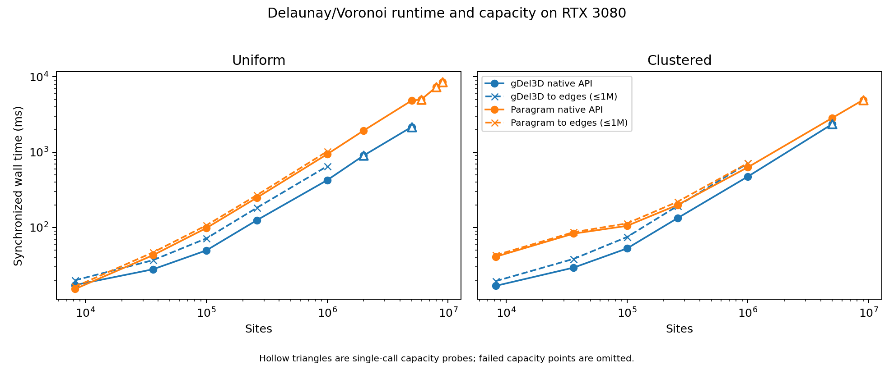
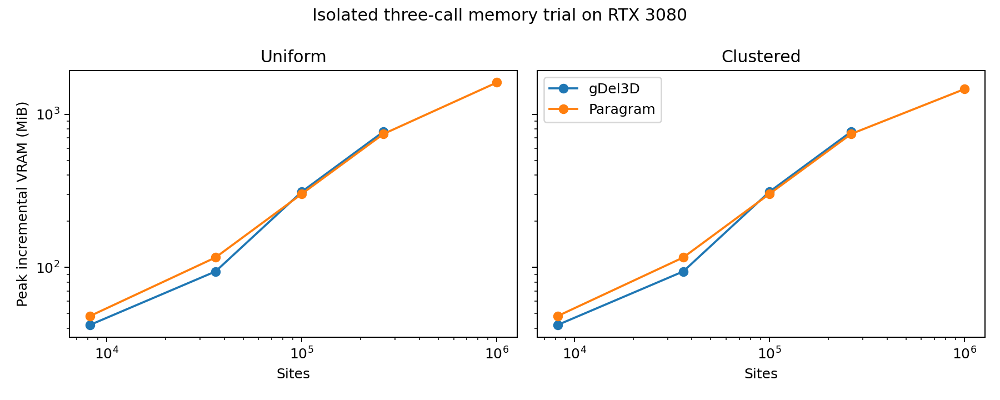

# Paragram evaluation for DCCVT

## Outcome

Paragram should **not replace `pygdel3d` in the current DCCVT training path** based on this RTX 3080 evaluation.

Upstream references: [Paragram repository](https://github.com/zenseact/paragram), [SIGGRAPH 2026 paper](https://arxiv.org/abs/2605.06408), and [public Python API](https://github.com/zenseact/paragram/blob/main/paragram/_api.py).

On the saved 36,120-site DCCVT workload, Paragram took 38.05 ms versus gDel3D's 29.85 ms for native construction, and 41.60 ms versus 37.79 ms when both outputs were converted to the same canonical edge graph. On the saved 262,144-site workload, Paragram took 243.67 ms versus 122.02 ms natively. Paragram's public result also remains an adjacency graph rather than the tetrahedron indices required by DCCVT's circumcenters, SDF gradients, CVT loss, clipping, and mesh extraction.

Paragram does show a capacity benefit. Its isolated three-call memory trial completed at one million sites with 1.43–1.58 GiB of incremental VRAM. The corresponding gDel3D child process terminated natively during the repeated memory trial, although the single-process timing calls completed at one million sites. This suggests better repeated-call memory scaling, not a hard claim that gDel3D cannot process one million sites.

The complete machine-readable result is in [paragram_evaluation_results.json](paragram_evaluation_results.json). It records Paragram commit `4f36b1f2c8738912c5efc056a06023d4c1d2da07`, package 0.1.0, all individual timing samples, environment details, status histograms, memory results, and input hashes.

## Test environment and method

- NVIDIA GeForce RTX 3080, 10 GiB; driver 580.173.02.
- PyTorch 2.7.1+cu126, Python 3.12.3, CUDA toolkit 12.0.
- Five measured repetitions after two warmups. Every timing is explicitly CUDA-synchronized.
- Raw time measures each backend's native API. “To edges” additionally converts gDel3D tetrahedra or Paragram CSR adjacency into the same unique undirected CUDA edge list.
- VRAM is a separate three-call child-process trial. A 1 ms sampler uses driver-level free memory, so it includes allocations outside PyTorch's caching allocator.
- Warm-start tests are controlled proxies: consecutive frames add Gaussian movement equal to 1% or 5% of the median Delaunay-edge length.
- The GPU had approximately 2.8 GiB of resident desktop/other allocations. Reported memory is the incremental decrease from each child process's post-initialization baseline.
- Paragram was installed from upstream `main`. A clean lazy CUDA build took 54.72 s; cached extension loads took approximately 0.02 s.

### Synthetic distributions

Both synthetic datasets use deterministic NumPy generation with seed 69 and contain unweighted `float32` points in the cube `[-1, 1]³`:

- **Uniform:** every x, y, and z coordinate is sampled independently from `U(-1, 1)`. The sites fill the domain without intentionally dense or empty regions.
- **Clustered:** ten cluster centers are sampled uniformly from `[-0.75, 0.75]³`. Each site is independently assigned to a random center, isotropic Gaussian noise with standard deviation `0.08` is added to each coordinate, and the result is clipped to `[-1, 1]³`. This produces dense local groups separated by relatively sparse regions.

The clustered dataset is useful for testing sensitivity to uneven spatial density, but it does not reproduce the paper's clustered generator. The paper distributes points evenly between 5 or 10 clusters in `[-10, 10]³` with standard deviation `0.1`; after normalizing its domain to `[-1, 1]³`, that standard deviation would be `0.01`, making the paper's clusters substantially tighter than ours.

### Timing columns: raw versus to edges

- **Raw** measures one synchronized call through each backend's native public API. For Paragram, the points are already on the GPU and the call returns CUDA CSR adjacency. For gDel3D, the Python call receives a NumPy array and returns host-side tetrahedra, so its raw wall time also includes the local wrapper's input conversion and output copy. These timings compare the APIs DCCVT can actually call, but their outputs and transfer boundaries are not equivalent.
- **To edges** starts before the backend-specific input preparation and stops after converting its result into the same canonical CUDA representation: a sorted, unique list of undirected Delaunay edges. Paragram's CSR neighbor pairs are canonicalized directly. Each gDel3D tetrahedron contributes its six vertex pairs, which are then transferred to CUDA, canonicalized, and deduplicated. This column is the fairer common-output comparison, but it is benchmark-only work and does not represent DCCVT's current tetrahedron-consuming production path.

Consequently, raw answers “how long does the native API call take?”, while to edges answers “how long until both backends provide the same edge-list output?” Neither column makes Paragram adjacency equivalent to the tetrahedra required by DCCVT.

The benchmark command was:

```bash
TORCH_EXTENSIONS_DIR=/tmp/paragram-benchmark-torch-extensions-20261117-rerun \
  .venv/bin/python scripts/benchmark_paragram.py \
  --output docs/paragram_evaluation_results.json
```

## Runtime results

The ratio column is `gDel3D time / Paragram time`: values above 1 mean Paragram is faster.

| Dataset | Sites | gDel3D raw (ms) | Paragram raw (ms) | Paragram raw ratio | gDel3D to edges (ms) | Paragram to edges (ms) | Edge F1 |
| --- | ---: | ---: | ---: | ---: | ---: | ---: | ---: |
| Uniform | 8,192 | 17.27 | 15.27 | 1.13× | 19.93 | 16.40 | 0.993360 |
| Uniform | 36,120 | 27.89 | 42.88 | 0.65× | 36.85 | 46.71 | 0.996523 |
| Uniform | 100,000 | 49.68 | 98.39 | 0.50× | 71.68 | 106.82 | 0.997913 |
| Uniform | 262,144 | 125.22 | 249.11 | 0.50× | 182.92 | 269.59 | 0.998674 |
| Uniform | 1,000,000 | 424.86 | 939.19 | 0.45× | 650.44 | 1,022.81 | 0.999320 |
| Clustered | 8,192 | 16.84 | 40.99 | 0.41× | 19.45 | 42.95 | 0.999357 |
| Clustered | 36,120 | 29.36 | 83.00 | 0.35× | 38.35 | 86.74 | 0.999494 |
| Clustered | 100,000 | 52.76 | 105.22 | 0.50× | 74.79 | 113.42 | 0.999549 |
| Clustered | 262,144 | 133.31 | 199.33 | 0.67× | 193.44 | 219.89 | 0.999721 |
| Clustered | 1,000,000 | 474.85 | 630.53 | 0.75× | 711.14 | 715.39 | 0.999876 |
| Saved DCCVT final | 36,120 | 29.85 | 38.05 | 0.78× | 37.79 | 41.60 | 0.999592 |
| Saved DCCVT grid | 262,144 | 122.02 | 243.67 | 0.50× | 179.59 | 263.77 | 0.998869 |



Paragram was faster only for the smallest uniform input. At the current saved DCCVT scale, substituting a hypothetical tetrahedron-capable backend with the measured raw ratio would project to approximately 0.938× total training throughput (about a 6% slowdown) using the existing 23.85% Delaunay profile share. This is an estimate only: the public Paragram API cannot currently supply the required tetrahedra.

## Memory results

| Dataset | Sites | gDel3D incremental MiB | Paragram incremental MiB |
| --- | ---: | ---: | ---: |
| Uniform | 8,192 | 42 | 48 |
| Uniform | 36,120 | 94 | 116 |
| Uniform | 100,000 | 312 | 302 |
| Uniform | 262,144 | 770 | 744 |
| Uniform | 1,000,000 | Native worker exit | 1,614 |
| Clustered | 8,192 | 42 | 48 |
| Clustered | 36,120 | 94 | 116 |
| Clustered | 100,000 | 312 | 302 |
| Clustered | 262,144 | 770 | 744 |
| Clustered | 1,000,000 | Native worker exit | 1,462 |
| Saved DCCVT final | 36,120 | 82 | 118 |
| Saved DCCVT grid | 262,144 | 770 | 744 |



Paragram consumes slightly more incremental memory at the current 36k scale and slightly less around 100k–262k. Its repeated one-million-site trial finished within the available RTX 3080 memory; the benchmark did not force or independently verify Paragram's automatic chunking mode.

## Large-scale capacity follow-up

A native-output-only follow-up pushed both backends beyond the original one-million-site sweep. It disables canonical edge conversion, warm starts, and the separate three-call memory trial so that the backend's own output is the capacity limit. The machine-readable summary is in [paragram_large_scale_results.json](paragram_large_scale_results.json).

| Distribution | Sites | gDel3D API wall (ms) | Paragram wall (ms) | Paragram configuration | Outcome |
| --- | ---: | ---: | ---: | --- | --- |
| Uniform | 2,000,000 | 900.81 | 1,932.55 | Automatic chunking | Both complete; Paragram 2.15× slower |
| Uniform | 5,000,000 | 2,160.02 | 4,837.15 | Automatic chunking | Both complete; Paragram 2.24× slower |
| Uniform | 6,000,000 | Not tested | 4,990.56 | 4 chunks | Paragram completes |
| Uniform | 8,000,000 | Not tested | 7,327.66 | 12 chunks, expandable allocator | Paragram completes |
| Uniform | 9,000,000 | Not tested | 8,524.08 | 16 chunks, expandable allocator | Paragram completes |
| Uniform | 10,000,000 | Native allocation exit | Failed | Multiple 4–16 chunk attempts | Neither backend completes reliably |
| Clustered | 5,000,000 | 2,363.40 | 2,849.24 | Automatic chunking | Both complete; Paragram 1.21× slower |
| Clustered | 9,000,000 | Native CUDA exit | 4,937.12 | 16 chunks, expandable allocator | Only Paragram completes |

The 2M and 5M Paragram values are medians of five measured runs after two warmups. The gDel3D values and all 6M–9M capacity probes are single isolated calls, so they establish feasibility rather than stable timing distributions. Non-success status rates remained small: 0.0060% for the 9M uniform case and 0.0008% for the 9M clustered case.

Nine million sites is the practical ceiling observed on this live 10 GiB RTX 3080, which had about 6.6 GiB free before the sweep. Paragram's default automatic chunking failed at 10M with an illegal CUDA memory access; explicit chunking progressed further but ultimately encountered OOMs or the same illegal access. Reaching the paper's 15M scale requires a larger-memory GPU or an upstream change that also chunks the dense adjacency workspaces, not only convex-cell scratch memory.

This strengthens Paragram's capacity case but not its speed case. It is slower at every large size where both backends finish, while successfully producing adjacency at 9M clustered sites where gDel3D exits natively. Further integration work is justified only if DCCVT is expected to grow into the multi-million-site regime or if avoiding gDel3D's hard native failures is more important than construction time.

## Adjacency and status behavior

Cold Paragram adjacency is close to the gDel3D-derived edge graph but not identical:

- Edge F1 ranges from 0.993360 to 0.999876.
- Precision ranges from 0.999654 to 1.0 except for similarly small deviations in the largest cases; recall ranges from 0.986808 to 0.999843. Paragram generally returns a near-subset of the gDel3D edge graph.
- The saved 36,120-site DCCVT case has precision 1.0, recall 0.999184, and no non-success cell statuses.
- The saved 262,144-site grid has 146 non-success cells (0.05569%): 63 vertex overflows, 52 plane overflows, and 31 inconsistent boundaries.
- Other cold cases contain between 0 and 44 non-success cells, except the small clustered case at 6 of 8,192 cells.

These differences may be acceptable for applications that consume only adjacency, but they cannot establish equivalence for DCCVT's tetrahedron-dependent geometry.

## Warm-start behavior

The documented previous-adjacency warm start is not usable with the returned Paragram CSR in this environment:

- More than 99% of cells report `inconsistent_boundary` on the first perturbed frame in every case; most remaining cells report `empty_cell` or an overflow status.
- Warm execution is generally slower than cold execution. Median cold/warm ratios range from 0.272× to 0.855×, except the invalid 8k clustered case at 1.10–1.15×.
- The behavior also reproduces with unchanged points in the CUDA smoke test, so it is not caused only by the perturbation magnitude.

This should be reported upstream before relying on warm starts. The benchmark preserves the full per-frame status and agreement records for diagnosis.

## Recommendation and possible follow-up

1. Keep `pygdel3d` as DCCVT's production tetrahedralization backend.
2. Keep Paragram optional for repeatable evaluation and future upstream testing; do not import it from production geometry code.
3. If large-scale capacity becomes the priority, first ask upstream whether Voronoi vertex/plane incidence can be exposed as tetrahedron indices. Paragram internally constructs cell vertices from three bisecting planes, so a maintained API extension may be possible, but it requires correctness and performance validation.
4. Treat a Voronoi-only DCCVT representation as a separate architectural project. It would need replacements for circumcenters, tetrahedral SDF gradients and losses, clipping, CVT accumulation, adaptive upsampling, and mesh face construction.
5. Only the RTX 3080 was visible during this phase. A 24–48 GiB GPU, such as the previously identified A6000, is the appropriate follow-up if reproducing the paper's 10M–15M range becomes relevant.

## Reproduction

Install the optional dependency and run the benchmark:

```bash
bash scripts/bootstrap.sh --with-paragram
.venv/bin/python scripts/benchmark_paragram.py \
  --output outputs/paragram_benchmark/results.json
```

For capacity-only runs that avoid the much larger canonical-edge conversion:

```bash
PARAGRAM_NUM_CHUNKS=16 \
PYTORCH_CUDA_ALLOC_CONF=expandable_segments:True \
  .venv/bin/python scripts/benchmark_paragram.py \
  --backend paragram --sizes 9000000 \
  --distribution uniform --no-default-npz \
  --repetitions 1 --warmups 0 \
  --no-warm-start --no-memory --no-common-output \
  --output outputs/paragram_benchmark/scale_uniform_9m.json
```

Render updated scaling figures from a result file:

```bash
.venv/bin/python scripts/plot_paragram_results.py \
  docs/paragram_evaluation_results.json \
  --large-scale-input docs/paragram_large_scale_results.json \
  --output-dir docs
```

The figures are generated deterministically with Matplotlib using the committed JSON results; no diffusion or generative-image model is involved. The runtime figure includes the native-output capacity sweep through 9M sites. The VRAM figure remains limited to 1M because memory trials were intentionally disabled for the large-scale sweep.

The default suite includes the known saved DCCVT NPZ files when present. Additional site arrays can be supplied with repeated `--npz PATH` options. Use `--help` for backend, distribution, size, repetition, warm-start, and memory controls.
